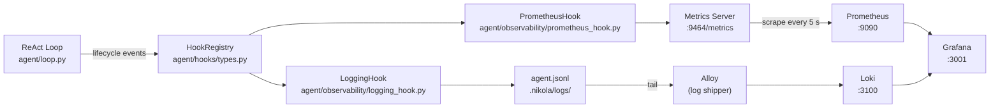

# Observability Stack

The harness ships a full observability stack: **Prometheus metrics**, **structured JSON logs**,
and a **Grafana dashboard** — all wired through reusable lifecycle hooks so instrumentation never
touches business logic.

---

## Architecture



---

## Hook protocol

Every harness component that fires events calls `HookRegistry.emit_*()` — it never imports
`prometheus_client` or the logging module directly. The registry dispatches to every registered
`ObservabilityHook` implementation in registration order.

A hook failure is caught, logged once, and silenced for that hook/method pair — hooks never
break the agent.

### Event types

| Event | Dataclass | Fired when |
|---|---|---|
| `RunStart` | `RunStartEvent` | A Turn begins |
| `RunEnd` | `RunEndEvent` | A Turn completes (any outcome) |
| `LLMCall` | `LLMCallEvent` | An LLM response is received |
| `ToolCall` | `ToolCallEvent` | A tool invocation completes |
| `SubAgentStart` | `SubAgentStartEvent` | A sub-agent begins executing |
| `SubAgentEnd` | `SubAgentEndEvent` | A sub-agent finishes |
| `SubAgentProgress` | `SubAgentProgressEvent` | Live counter update during sub-agent run |
| `MemoryOperation` | `MemoryOperationEvent` | A memory read or write completes |
| `MCPServer` | `MCPServerEvent` | An MCP server connects, disconnects, or fails |

`SubAgentProgress` fires on every LLM response and every tool-call batch inside a sub-agent.
Hooks that persist data should sample or skip it; it exists for live terminal displays.

---

## Prometheus metrics

Served at `http://localhost:9464/metrics`. Prometheus scrapes this endpoint every 5 s.

### Run metrics

| Metric | Type | Labels | Description |
|---|---|---|---|
| `agent_runs_total` | Counter | `agent`, `status` | Completed turns; status = `success` / `guard` / `error` |
| `agent_active_runs` | Gauge | `agent` | Turns currently in flight |
| `agent_run_duration_seconds` | Histogram | `agent` | End-to-end turn latency |
| `agent_run_iterations` | Histogram | `agent` | ReAct steps per turn |

### LLM metrics

| Metric | Type | Labels | Description |
|---|---|---|---|
| `agent_llm_calls_total` | Counter | `model`, `status` | LLM API calls; status = `success` / `error` |
| `agent_llm_call_duration_seconds` | Histogram | `model` | Time waiting for the LLM |
| `agent_llm_tokens_total` | Counter | `model`, `type` | Tokens consumed; type = `prompt` / `completion` |

### Tool metrics

| Metric | Type | Labels | Description |
|---|---|---|---|
| `agent_tool_calls_total` | Counter | `tool`, `source`, `status` | Tool invocations; source = `builtin` / `mcp` |
| `agent_tool_call_duration_seconds` | Histogram | `tool`, `source` | Tool execution latency |

### Permission metrics

| Metric | Type | Labels | Description |
|---|---|---|---|
| `agent_permission_decisions_total` | Counter | `tool`, `outcome` | Gate decisions; outcome = `allow` / `deny` / `ask_yes` / `ask_no` / `none` |

### Sub-agent metrics

| Metric | Type | Labels | Description |
|---|---|---|---|
| `agent_subagent_runs_total` | Counter | `role`, `status` | Sub-agent completions per role |
| `agent_active_subagents` | Gauge | `role` | Sub-agents currently running |
| `agent_subagent_duration_seconds` | Histogram | `role` | Wall-clock delegation latency |
| `agent_subagent_iterations` | Histogram | `role` | ReAct steps inside each sub-agent |

### Memory metrics

| Metric | Type | Labels | Description |
|---|---|---|---|
| `agent_memory_operations_total` | Counter | `operation`, `backend`, `status` | Memory reads/writes; backend = `sqlite` / `qdrant` |
| `agent_memory_operation_duration_seconds` | Histogram | `operation`, `backend` | Memory operation latency |
| `agent_memory_search_results` | Histogram | `backend` | Memories returned per search query |

**Quick check:**

```bash
curl -s localhost:9464/metrics | grep '^agent_'
curl -s localhost:9464/metrics | grep '^agent_subagent'
curl -s localhost:9464/metrics | grep '^agent_permission'
```

---

## Structured logs

`LoggingHook` writes one JSON object per event to `.nikola/logs/agent.jsonl`.
The terminal shows only the conversation transcript — log records never interleave with it.

**Always-present fields:**

| Field | Description |
|---|---|
| `ts` | ISO-8601 UTC timestamp |
| `level` | `DEBUG` / `INFO` / `WARNING` / `ERROR` |
| `logger` | Python logger name |
| `session` | Session ID |
| `event_type` | Hook event category (e.g. `tool_call`, `llm_call`, `subagent_end`) |

**Additional fields by event:**

| Event | Extra fields |
|---|---|
| `tool_call` | `tool`, `permission_outcome`, `duration_ms`, `success` |
| `llm_call` | `model`, `prompt_tokens`, `completion_tokens`, `duration_ms` |
| `subagent_start` | `subagent_id`, `role`, `task_length` |
| `subagent_end` | `subagent_id`, `role`, `success`, `iterations`, `tools_used`, `duration_ms` |
| `memory_operation` | `operation`, `backend`, `success`, `duration_ms`, `results` |

Sub-agent records also carry `parent_session` — the field that ties a delegated run back to
the parent turn that spawned it.

**Example record (INFO):**

```json
{
  "ts": "2025-01-15T10:30:45.123Z",
  "level": "INFO",
  "logger": "agent.observability.logging_hook",
  "session": "sess-abc123",
  "event_type": "tool_call",
  "tool": "read_file",
  "permission_outcome": "allow",
  "duration_ms": 42
}
```

**Useful `jq` queries:**

```bash
# All tool calls
jq 'select(.event_type == "tool_call")' workspace/.nikola/logs/agent.jsonl

# Sub-agent completions
jq 'select(.event_type == "subagent_end")' workspace/.nikola/logs/agent.jsonl

# Permission denials
jq 'select(.permission_outcome == "deny")' workspace/.nikola/logs/agent.jsonl

# Failed LLM calls
jq 'select(.event_type == "llm_call" and .success == false)' workspace/.nikola/logs/agent.jsonl

# Live tail
tail -f workspace/.nikola/logs/agent.jsonl | jq .
```

Log files rotate at 5 MB, keeping 3 older copies. The path defaults to
`<workspace>/.nikola/logs/agent.jsonl`; override with `logging.file` in `config.yaml`.

---

## Loki + Alloy

Alloy tails `agent.jsonl` and ships records into Loki. Indexed labels: `service`, `level`.
Structured metadata labels: `logger`, `session`, `run`, `event_type`, `tool`.

**LogQL examples:**

```logql
# All events from the agent service
{service="agent"}

# Single session (drill into one run)
{service="agent"} | json | session="<session-id>"

# Tool calls only
{service="agent"} | json | event_type="tool_call"

# Sub-agent completions
{service="agent"} | json | event_type="subagent_end"
```

Access Loki through **Grafana → Drilldown → Logs** at <http://localhost:3001>.

---

## Grafana dashboard

The **Agent Metrics** dashboard is auto-provisioned from
`grafana/dashboards/agent-metrics.json`. It opens by default when you navigate to
<http://localhost:3001> (anonymous admin, no login required).

### Dashboard panels

| Panel | What it shows |
|---|---|
| Agent throughput | Turns completed per minute |
| Active runs | In-flight turns at any moment |
| Run latency (p50 / p95 / p99) | End-to-end turn duration |
| Success / failure rates | `success` vs `guard` vs `error` outcomes |
| LLM token usage | Prompt + completion tokens, cumulative and per-turn |
| LLM latency | Time spent waiting for the model |
| Tool calls — built-in vs MCP | Volume split by source |
| Tool latency | Per-tool p50/p95 |
| Permission decisions | `allow` / `deny` / `ask_yes` / `ask_no` breakdown |
| Sub-agent runs by role | Delegations per role (`file-scout`, `scheduler`, `general`) |
| Active sub-agents | Concurrently running delegations |
| Sub-agent latency | Wall-clock delegation time per role |
| Memory operations | Reads / writes per backend (`sqlite` / `qdrant`) |

!!! note "Empty dashboard is normal"
    A freshly started agent publishes almost no data until its first turn. Flat panels
    before any interaction are expected.

---

## Services reference

| Service | URL | Purpose |
|---|---|---|
| Agent metrics | <http://localhost:9464/metrics> | Prometheus scrape endpoint |
| Prometheus | <http://localhost:9090> | Query metrics, check scrape targets |
| Grafana | <http://localhost:3001> | Dashboard + Loki log browsing |
| Loki | <http://localhost:3100> | Log store (queried via Grafana) |
| mitmproxy UI | <http://localhost:9091> | Inspect raw LLM HTTP traffic |

Check scrape health at <http://localhost:9090/targets> — both `agent:9464` and
`host.docker.internal:9464` should show **UP**.
