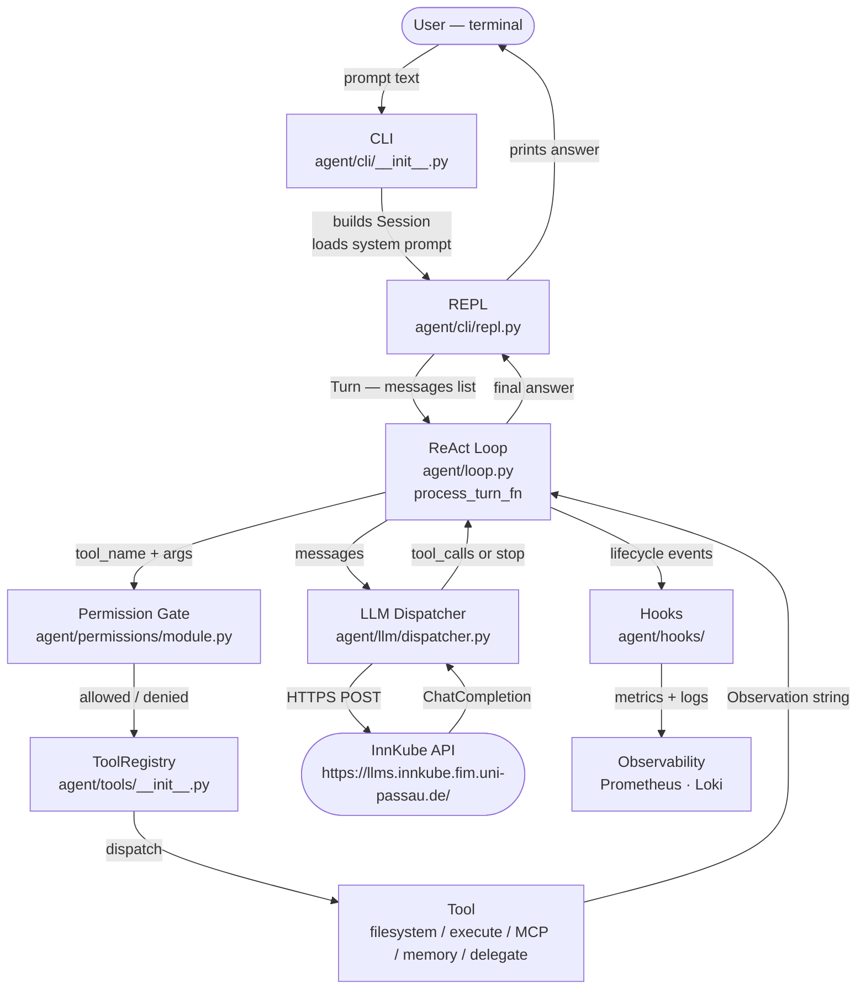

# System Overview

The agent harness is a terminal-based **ReAct loop** that pairs an LLM with a restricted set of
tools, running inside a container sandbox. This page walks through how a request flows from the
user's keyboard to a final answer, and maps each step to the module that implements it.

---

## Request flow



---

## Step by step

### 1 — CLI startup (`agent/cli/__init__.py`)

`main()` parses flags (`--prompt`, `--mode`, `--config`, `--stream`, `--thinking`,
`--permissions`), loads `config.yaml`, reads `INNKUBE_ACCESS_TOKEN`, builds the
LLM client and dispatcher, constructs the `ToolRegistry`, loads the permission policy,
and connects any MCP servers listed in `.nikola/mcp.json`.  
It then creates a **Session** and hands it to the REPL.

### 2 — Session (`agent/cli/session.py`)

A Session holds everything that lives for the lifetime of one agent process:

- `messages` — the growing OpenAI-spec conversation history
- `mode` — which system prompt is active (e.g. `default`, `readonly`)
- `tools` — the ToolRegistry
- `ui` — the ConsoleUI (the only writer to the terminal)

`load_system_prompt` selects `agent/prompts/<mode>.md` and prepends it to messages.

### 3 — REPL (`agent/cli/repl.py`)

`run_repl` reads a line from stdin. If the line starts with `/` it is dispatched to the
command registry (`/help`, `/exit`, `/tools`, `/context`, `/permissions`, …). Otherwise
it becomes a **Turn** and is forwarded to `process_turn_fn`.

### 4 — ReAct loop (`agent/loop.py`)

`process_turn_fn` is a closure that owns the full Thought → Action → Observation cycle:

1. Append the user message to `messages`.
2. Call the LLM dispatcher with the full message history.
3. If the response has `tool_calls` → extract tool name + arguments → go to step 5.
4. If finish reason is `stop` → return the content as the final answer.
5. Call `PermissionGate.check(tool_name, args)`.
6. If allowed → call `ToolRegistry.dispatch(tool_name, args)` → receive Observation string.
7. Append the Observation as a `{"role": "tool", …}` message → go back to step 2.

**Loop guards** ensure the loop always terminates: iteration cap (`loop.max_iterations`),
token budget (`context.window_tokens`), and time budget (LLM `timeout_seconds`).
When a guard fires, `process_turn_fn` returns a synthetic answer string such as
`"[Loop terminated: max iterations reached]"` — it never raises.

### 5 — Permission Gate (`agent/permissions/module.py`)

Before every tool call the gate evaluates `permissions.yaml` rules top-to-bottom.
Three outcomes:

| Outcome | Effect |
|---|---|
| `allow` | Proceeds silently |
| `ask` | Pauses and prompts the user with a four-option menu; re-prompts on every call (the session cache is bypassed for `ask`) |
| `deny` | Returns an error Observation immediately; no tool runs |

**One-shot mode** (`--prompt`) uses the same confirmation channel as the REPL, so `ask`
still prompts; with non-interactive stdin the menu reads EOF and the call is denied. In
**sub-agent mode** there is no channel at all, so `ask` is turned into `deny` outright.

### 6 — ToolRegistry + Tools (`agent/tools/`)

`ToolRegistry.dispatch(tool_name, args)` looks up the handler and calls it.
All tools return a plain string — success result or `"Error: <reason>"`.
Tools never raise to the loop; errors become Observations the LLM reasons about.

The registry holds four categories of tools at runtime:

| Category | Examples |
|---|---|
| Built-in filesystem | `read_file`, `write_file`, `list_files`, `search_text`, … |
| Built-in execution | `execute_command` (sandboxed, permission-gated) |
| MCP tools | `mcp_calendar__create_event`, `mcp_chrome__screenshot`, … |
| Delegation | `delegate`, `delegate_parallel` |
| Memory | `remember`, `search_memory` |

### 7 — LLM Dispatcher (`agent/llm/dispatcher.py`)

A thin wrapper around the OpenAI SDK that resolves model, timeout, and base URL **once**
at construction from `config.yaml`. The loop only passes `messages`; all other parameters
are fixed. Two variants: `make_chat_completions_effect` (non-streaming, used by sub-agents
and tests) and `make_chat_completions_stream_effect` (streaming, used by the REPL).

### 8 — Hooks + Observability (`agent/hooks/`, `agent/observability/`)

The loop fires lifecycle events at eight points:

| Event | Fired when |
|---|---|
| `RunStart` / `RunEnd` | A Turn begins / ends |
| `LLMCall` | After each LLM response |
| `ToolCall` | After each tool invocation |
| `PermissionCheck` | After each gate evaluation |
| `SubAgentStart` / `SubAgentEnd` / `SubAgentProgress` | Sub-agent lifecycle |
| `MemoryOperation` | A memory read or write |

`PrometheusHook` turns these into `agent_*` Prometheus series (served at `:9464/metrics`).
`LoggingHook` writes structured JSON lines to `.nikola/logs/agent.jsonl`.

---

## Module layout

```
agent/
├── cli/                 ← Entry point, REPL, Session, ConsoleUI, slash commands
├── loop.py              ← make_process_turn_fn() → the ReAct loop closure
├── prompts/             ← System prompt files (one per Agent Mode)
├── tools/               ← ToolRegistry + filesystem + execute tools
├── permissions/         ← PermissionGate, PermissionPolicy, rule evaluation
├── subagents/           ← Roles, orchestrator, parallel delegation, progress cards
├── hooks/               ← HookHandler protocol, hook registry
├── memory/              ← MemoryStore (SQLite), VectorStore (Qdrant), tools, policy
├── mcp/                 ← MCP Manager, stdio client, HTTP client, config parser
├── context/             ← Token budget, 3-tier compaction, rules loader
├── skills/              ← Skill discovery, load_skill tool, built-in skills
├── observability/       ← PrometheusHook, LoggingHook, metrics HTTP server
└── llm/                 ← OpenAI client factory, streaming + non-streaming dispatchers
```

See [Concepts](../concepts/execution-model.md) for detailed descriptions of Session, Turn,
Step, and Loop Guard, and [Observability Stack](observability.md) for the full metrics and
logging reference.
