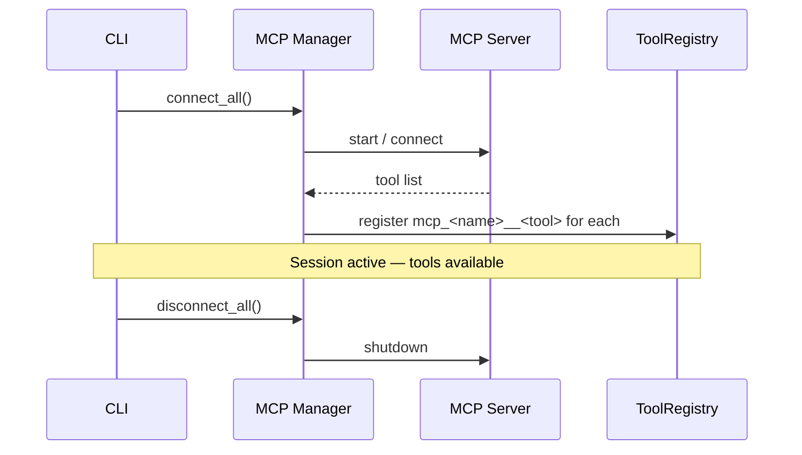

# MCP Integration

The harness connects to external **MCP Servers** at Session start and exposes their tools
alongside built-in tools — the LLM sees them all in one flat list.

---

## Concepts

### MCP Server

An external process that exposes capabilities (tools, resources, prompts) via the
[Model Context Protocol](https://modelcontextprotocol.io). Configured in
`.nikola/mcp.json` and connected at Session start. Each server runs as either a
subprocess (stdio transport) or an HTTP endpoint.

### MCP Client

The harness-side abstraction that connects to one MCP Server and translates between the
harness's Tool schema and the MCP protocol. Two variants:

| Client | Transport | When to use |
|---|---|---|
| `StdioMCPClient` | JSON-RPC over subprocess stdin/stdout | Local tools (npm packages, Python scripts) |
| `HttpMCPClient` | JSON-RPC over HTTP / SSE | Remote or containerised servers |

### MCP Manager

Orchestrates the full lifecycle of all configured MCP Servers:

1. Load `.nikola/mcp.json`
2. Instantiate a client per server
3. Connect at Session start → discover tools → register in ToolRegistry
4. Disconnect at Session end

The manager owns neither subprocesses nor protocol details — clients encapsulate those.

---

## Configuration (`.nikola/mcp.json`)

Located at `<workspace>/.nikola/mcp.json`. See
[Configuration → .nikola/mcp.json](../getting-started/configuration.md#nikolamcpjson)
for the full field reference.

```json
{
  "mcpServers": {
    "calendar": {
      "type": "http",
      "url": "http://mcp_calendar:3000/mcp",
      "description": "Calendar management"
    },
    "chrome-devtools": {
      "type": "stdio",
      "command": "npx",
      "args": ["-y", "chrome-devtools-mcp@latest", "--slim", "--headless"],
      "description": "Requires Node.js / npx on the host — see stdio prerequisites below"
    }
  }
}
```

### Environment variable substitution

Use `${VAR}` syntax in `env` values to inject secrets at runtime:

```json
{
  "mcpServers": {
    "my-service": {
      "type": "stdio",
      "command": "my-tool",
      "env": { "API_KEY": "${MY_SERVICE_API_KEY}" }
    }
  }
}
```

The `${VAR}` is replaced with the corresponding environment variable value before the
subprocess is started. Never hardcode secrets in `mcp.json`.

---

## Tool naming

MCP tools are registered as:

```
mcp_<server-name>__<tool-name>
```

Examples:

| Server name | MCP tool name | Registered as |
|---|---|---|
| `calendar` | `create_event` | `mcp_calendar__create_event` |
| `calendar` | `list_events` | `mcp_calendar__list_events` |
| `chrome-devtools` | `screenshot` | `mcp_chrome-devtools__screenshot` |

This naming convention ensures MCP tools never collide with built-in tools and can be
targeted by permission rules using glob patterns (e.g. `mcp_calendar__*`).

---

## Lifecycle



---

## Permission handling

MCP tools follow the same permission rules as built-in tools. Common patterns:

```yaml
# Allow all tools from a trusted server
- tool: "mcp_calendar__*"
  action: allow

# Deny a specific MCP tool
- tool: "mcp_calendar__delete_event"
  action: deny
```

MCP tools that match no explicit rule fall through to `default: ask`.

!!! warning "Sub-agents and MCP tools"
    Inside a sub-agent, `ask` is auto-denied — there is no terminal to prompt.
    To allow a sub-agent to use MCP tools, add an explicit `allow` rule for those tools
    in the sub-agent's role configuration or in `permissions.yaml`.

---

## Inspecting connected servers

At runtime:

```
/mcp
```

Lists all connected servers, their transport type, and the tools registered from each.

At the shell:

```bash
curl -s localhost:9464/metrics | grep 'mcp_server'
```

Shows MCP server connection events from the Prometheus metrics.
